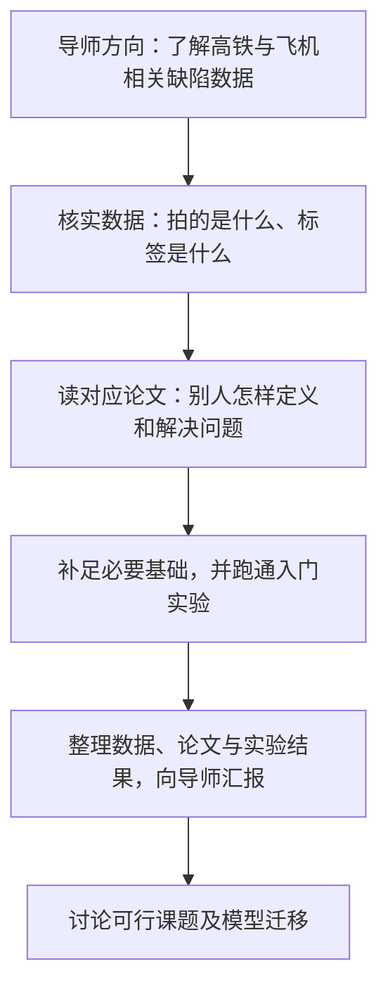
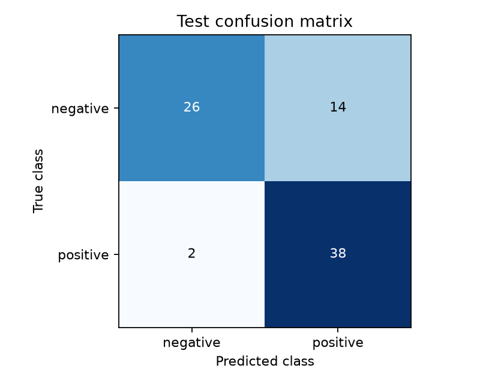

# 节点001：从研究方向到第一次训练的完整回顾

记录日期：2026-10-29。以下保留本次对话上一条完整教学回答的内容，仅将图片路径改成网页可使用的相对路径。

**你现在已经走到了“亲手跑通第一个深度学习分类实验”的位置。** 我刚检查了项目：你确实完成了 **5 轮训练，测试集 80 张图，判断正确 64 张，准确率 80%**。接下来最需要补上的，是理解这个实验怎样运行、结果代表什么，以及你能否自己再完成一次。

**① 先把已经做过的事情摆清楚**

| 状态 | 具体内容 | 谁完成的 |
|---|---|---|
| 已经做过 | 检查外接硬盘，梳理碳纤维外观数据和复合材料冲击数据 | 我检查、整理，你提出需求 |
| 已经做过 | 解压学习数据，检查类别、重复图片和文件问题 | 我完成 |
| 已经做过 | 准备碳纤维分类论文、ResNet 论文及中文批注 | 我准备 |
| 你报告已做过 | 阅读一篇相关论文 | 你阅读；目前记录不足以确认具体哪篇、读到什么程度 |
| 讨论过，仍需巩固 | 卷积、激活函数、池化、全连接、损失、梯度等 | 我解释，你提问并复述理解 |
| 已经实际操作 | 选择 Python 解释器、操作终端、安装依赖 | 你操作，我指导 |
| 已经实际操作 | 保存并运行训练代码，完成 5 轮训练 | 我写代码，你执行 |
| 尚未验证能否独立完成 | 从创建文件、检查环境，到运行和解释结果 | 下一步重点 |
| 尚未开始 | 高铁与复合材料之间的迁移对比、独立研究创新 | 等数据和基础实验可靠后推进 |

你之前不断调整我的教学方式，核心要求其实很一致：**代码可以由我写，但操作过程、文件作用和判断方法必须教给你。** 前面的讲解确实没有充分围绕这一点组织。

**② 导师方向、当前练习和后续研究是什么关系**

三张截图提供的是一批候选数据：复合材料外观、冲击损伤、红外热成像、高铁涂层、钢轨及钢桥涂层。它们的材料、成像方式和标签并不相同，需要先核实能做什么。

按照你对录音的转述，目前可以沿着下面这条线走；录音中的具体要求还不能全部当成已经核实的原话。



**你现在处于 D。** 选择碳纤维外观二分类作为入门，是我的教学建议。它能帮助你练习完整流程；它还不能证明你已经解决飞机缺陷检测，也不能证明两类材料之间可以直接迁移。

**③ 你这一次究竟训练了什么**

你使用的模型可以理解为：

> 已经学过大量普通图片的 ResNet18，负责提取图像特征；你给它接上一个新的分类层，学习区分当前数据集的两类图片。

本次代码中：

- 前面的特征提取部分保持固定。
- 最后的分类层参与训练，共 **1,026 个可训练参数**。
- 400 张图片分成：训练 280 张、验证 40 张、测试 80 张。
- 训练数据用于调整参数；验证数据用于选择模型；最终用测试数据检查效果。

这是本次真实生成的混淆矩阵：



纵向是真实类别，横向是模型判断：

- 40 张 `negative` 中，26 张判断正确，14 张误判为 `positive`。
- 40 张 `positive` 中，38 张判断正确，2 张漏判为 `negative`。

因此，以 `positive` 为要检出的类别：

- **召回率：38÷40＝95%**——真实属于这一类的图片，找出了多少。
- **查准率：38÷52≈73.1%**——模型报为这一类的图片，有多少确实属于这一类。

这里的类别含义应沿用数据集定义：`negative` 包括无缺陷或允许范围内的部分可修复外观情况，不能简单理解成“绝对没有任何缺陷”。

你已经完成了一个有实际结果的练习。不过，目前采用图片级划分，缺少试件身份信息，因此这组结果还不足以说明模型对新部件、新工况的表现。

**④ 一个 `.py` 文件到底怎样运行**

拿你的实际项目来说，一次运行的关系是：

```text
你在终端输入运行命令
        ↓
指定的 Python 解释器开始工作
        ↓
读取 train_transfer.py 源码
        ↓
导入虚拟环境里已经安装的库
        ↓
按照 config.json 找到图片
        ↓
训练、评估，并按代码要求保存结果
```

各个文件的作用如下。

| 对象 | 在你的项目里做什么 | 怎样出现的 |
|---|---|---|
| `train_transfer.py` | 写明读图、建模型、训练、评估、画图的步骤 | 我提供代码，你创建并保存 |
| `.venv` | 存放本项目的 Python 环境和所需库 | 提前创建，再安装依赖 |
| `torch`、`torchvision`、`matplotlib` 等 | 提供神经网络、模型和画图功能 | 安装得到，写 `import` 不会自动安装 |
| `config.json` | 告诉程序数据在哪里 | 我提前编写 |
| `requirements.txt` | 列出需要安装的库 | 我提前编写；文件存在不代表已经安装 |
| `.vscode/settings.json` | 帮 VS Code 选择本项目解释器 | 提前配置 |
| `run.ps1` | 把较长的启动命令包装起来 | 我提前编写，属于便利工具 |
| `runs` 下的本次结果目录 | 存放模型、指标和图片 | 程序运行时按代码创建 |
| `weights` 中的预训练权重 | 提供别人训练好的参数 | 代码触发首次下载，之后可以复用 |

所以，**其他脚本和配置文件不会因为你创建了 `.py` 就自动配齐。** 本项目里有些是我提前写好的，有些是程序运行后生成的。

一个简单练习完全可以只有一个 `.py` 源码文件。例如只执行 `print()`，装好 Python 就能运行。如果代码用到了 PyTorch，就需要选用已经安装 PyTorch 的环境。

同一个项目里增加小实验，通常可以继续使用现有 `.venv`。独立项目，或者需要彼此冲突的库版本时，再考虑新环境。

还有两个容易混淆的地方：

- **VS Code 选择的解释器**决定其运行按钮通常使用哪个 Python；终端里直接输入 `python`，不一定指向同一个环境。
- **终端当前目录**决定相对路径从哪里寻找文件。使用完整路径可以减少这类困惑；本项目代码也专门处理了项目位置，但其他程序不一定这样写。

**⑤ 现在只做一个小练习：自己创建并运行最简单的文件**

这次不训练模型，只验证你能把“文件—解释器—运行结果”连接起来。

1. 在 VS Code 左侧找到 `surface_defect_learning` 文件夹，右键选择“新建文件”，命名为 `hello_project.py`。
2. 输入下面两行，然后按 **Ctrl＋S** 保存：

   ```python
   import sys
   print("这个文件是我创建并运行的。\n使用的 Python：" + sys.executable)
   ```

3. 点击下方终端，在 `PS ...>` 后面粘贴整行命令，按 **Enter**：

   ```powershell
   & 'D:\VS Code Projects\Python\surface_defect_learning\.venv\Scripts\python.exe' 'D:\VS Code Projects\Python\surface_defect_learning\hello_project.py'
   ```

**成功标志：**终端显示“这个文件是我创建并运行的”，下一行显示本项目 `.venv\Scripts\python.exe` 的路径，随后重新出现 `PS ...>` 提示符。这个练习不需要安装新库，也不需要额外配置文件。
